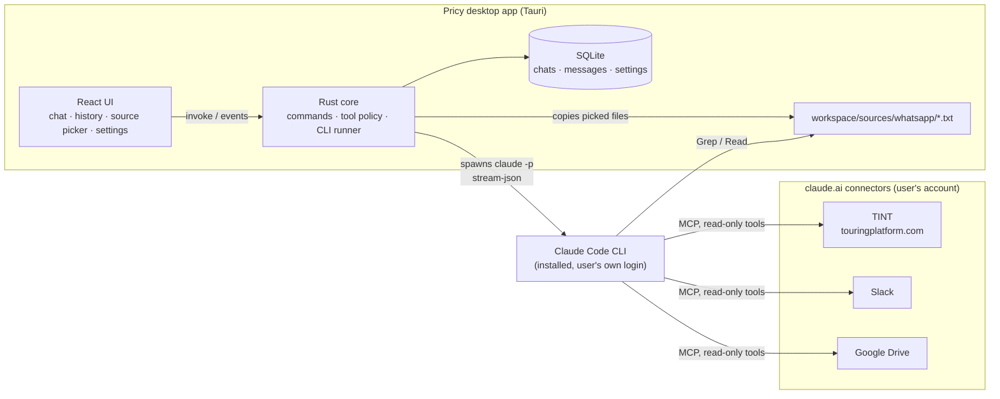
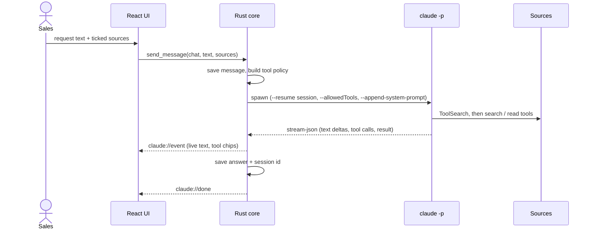

# Pricy — architecture

Pricy is a desktop app for Sales and Operations that finds an existing price for a service in a request — mainly transfers (with travel time) and tours — by searching the company's shared data: TINT, Slack, WhatsApp supplier chats and Google Drive price tables.

Target workflow: [expected_workflow.png](expected_workflow.png). How the current build covers it: [Workflow coverage](#workflow-coverage).

## Components

| Part | Where | Responsibility |
|---|---|---|
| UI | [src/](../src) | Chat with streamed answers, history (search, date groups), source checkboxes, settings |
| Commands and state | [src-tauri/src/lib.rs](../src-tauri/src/lib.rs) | Chats, messages, settings, sources, WhatsApp file management |
| CLI runner | [src-tauri/src/claude.rs](../src-tauri/src/claude.rs) | Finds `claude`, runs a turn, parses `stream-json`, lists connectors |
| Sources and tool policy | [src-tauri/src/sources.rs](../src-tauri/src/sources.rs) | Source definitions, per-turn allow/deny rules and instructions |
| Workflow | [src-tauri/src/workflow.rs](../src-tauri/src/workflow.rs), [src/Workflow.tsx](../src/Workflow.tsx) | Request state machine, Claude steps (drafts, final answers), send dialog, token usage |
| Storage | [src-tauri/src/db.rs](../src-tauri/src/db.rs) | SQLite schema and migrations |
| Assistant instructions | [src-tauri/src/system_prompt.md](../src-tauri/src/system_prompt.md) | How to answer: price, conditions, source, date; never invent prices |

## One search, end to end

- **One chat = one Claude session.** Follow-up questions use `--resume <session_id>`. Sessions are stored by the CLI, scoped to the app's fixed working directory (`workspace/`).
- **Isolation.** `--setting-sources ""` ignores the user's own Claude Code settings, CLAUDE.md files and hooks. Environment variables from a parent Claude Code session are removed before spawning, because they hide the claude.ai connectors from the child.
- **No API key.** Each user's existing Claude login is used, so every staff member needs Claude Code installed and signed in.

## Data sources

| Source | Access | Read-only enforcement | Setup |
|---|---|---|---|
| TINT | claude.ai connector `claude.ai TINT-staging` (MCP) | Only tools matching read-type name patterns are allowed (`*search*`, `*get_*`, `*list*`, `*read*`, `*find*`, `*fetch*`, `*query*`, `*download*`, `*lookup*`); everything else is denied in headless mode | Connect at claude.ai → Settings → Connectors |
| Slack | claude.ai connector `claude.ai Slack` | Same patterns | Same |
| Drive | claude.ai connector `claude.ai Google Drive` | Same patterns (search, read, download; no create, copy or share) | Same |
| WhatsApp | `.txt` chat exports picked in Settings, copied to `workspace/sources/whatsapp/` | Only `Read` / `Grep` / `Glob`, and only when a local source is ticked; no write or shell tools exist | Settings → Attach .txt export |
| Saved answers | Supplier answers recorded in Pricy, `workspace/sources/answers/*.md` | Same as WhatsApp | Filled by *Record supplier answer…* |

Per search, [sources.rs](../src-tauri/src/sources.rs) turns the ticked sources into:
- `--allowedTools`: `ToolSearch`, read patterns for each ticked connector, and `Read`/`Grep`/`Glob` if WhatsApp is ticked;
- `--disallowedTools`: all built-in tools that can write, run commands, browse the web or start agents;
- `--append-system-prompt`: which sources are enabled, how to search each one, and the WhatsApp file names.

Design notes, verified with CLI 2.1.197:
- claude.ai connectors load on demand through `ToolSearch` (deferred tools). Limiting built-in tools with `--tools` also hides them, so unwanted built-ins are blocked by name instead.
- Wildcard allow rules work for MCP tool names: `mcp__claude_ai_Google_Drive__*search*` allowed `search_files`, and `create_file` was denied.
- Connector status comes from `claude mcp list` (about 20–40 s, run in the background).

## Local storage

`~/Library/Application Support/com.coax.pricy/` (macOS):

| Path | Contents |
|---|---|
| `pricy.db` | `chats` (title, Claude session id, workflow status), `messages` (role, kind, content, searched sources, token usage), `settings` (CLI path, model, team, ticked sources, connector names) |
| `workspace/` | Working directory for the CLI; Claude sessions are keyed to it |
| `workspace/sources/whatsapp/` | Copies of attached WhatsApp exports |
| `workspace/sources/answers/` | Supplier answers recorded in Pricy (the **Saved answers** source) |

## Workflow coverage

Compared with [expected_workflow.png](expected_workflow.png). The state machines behind each step are in [WORKFLOW.md](WORKFLOW.md).

| Step | Owner | Status | How |
|---|---|---|---|
| 1. Sales request (booking no., date, pax, service type, itinerary / tour details, pick-up / drop-off, notes) | Sales | 🟡 Partial | Free text; Claude asks for missing details. No structured form yet. |
| 2. Claude checks the database | Claude | 🟢 Done | Searches the ticked sources (incl. **Saved answers**); a hidden marker sets *Price found* / *No price*. |
| A3. Operations approves | Ops | 🟢 Done | *Send for approval…* emails the picked team members; *Approved* / *Not correct* are recorded in the request. |
| A4. Claude sends the result to Sales | Claude | 🟢 Done | Claude writes the **Final answer** card; *Send to Sales…* emails it. |
| B3. Claude prepares the supplier message | Claude | 🟢 Done | *Draft supplier message* (also automatic after *Not correct*). |
| B4. Operations sends it | Ops | 🟢 Done | *Send to Operations…* emails the draft; Ops forwards it to the supplier outside Pricy. |
| B5. Save the answer for future requests | Ops | 🟢 Done (local) | *Record supplier answer…* saves it to **Saved answers**, which later searches use. Local to each computer. |
| B6. Claude sends the answer to Sales | Claude | 🟢 Done | Final answer from the supplier reply; *Send to Sales…*. |

## Open decisions

1. **Shared state between Sales and Ops**: today approvals are recorded by the person running the request, and messages go by email. A shared backend or Slack would give Ops their own inbox.
2. **Shared Saved answers** (B5): saved locally for now; a Drive sheet or TINT would share them across the team.
3. **Structured request form** for step 1, and whether the booking number comes from TINT.
4. **TINT staging vs production**, and whether login is per user.
5. **Distribution:** macOS only or Windows too; code signing; whether every staff member has a Claude Code seat.

## Known limitations

- Read-only enforcement relies on tool-name patterns. A connector tool that writes but is named like a read (e.g. `get_and_update_…`) would be allowed: review each connector's tool list once it is authenticated.
- `Read` is not restricted to the WhatsApp folder by path; the CLI's own working-directory rules and the prompt keep it there.
- WhatsApp files are copied, not linked: re-attach a newer export to update it.
- History and attached files are local to each computer.
