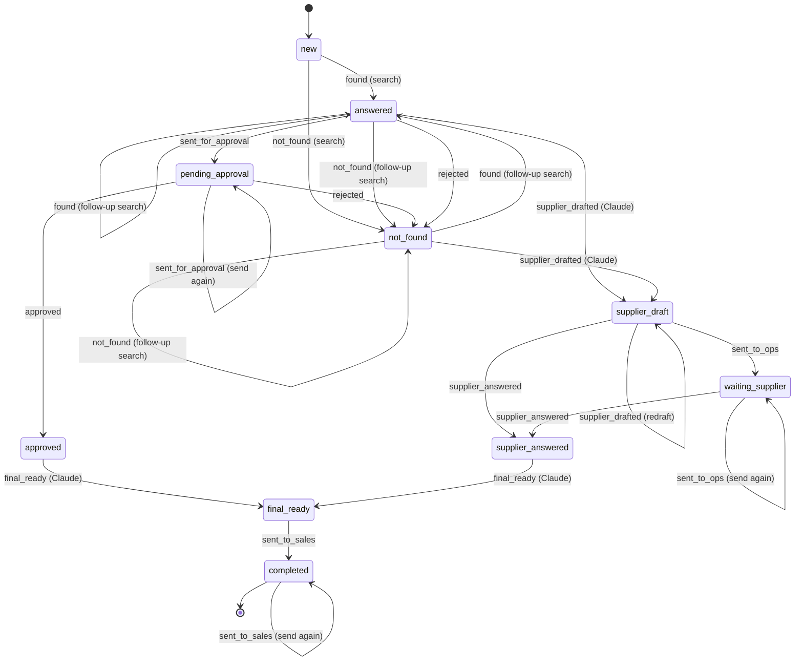
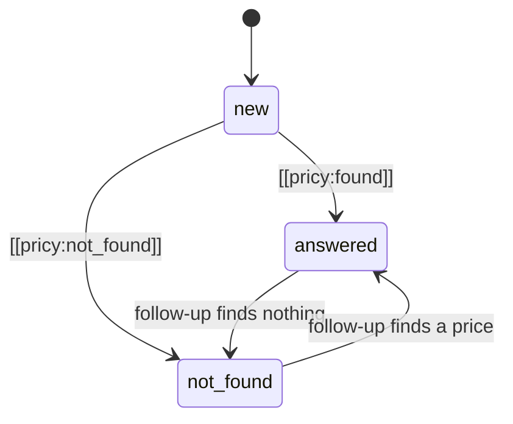
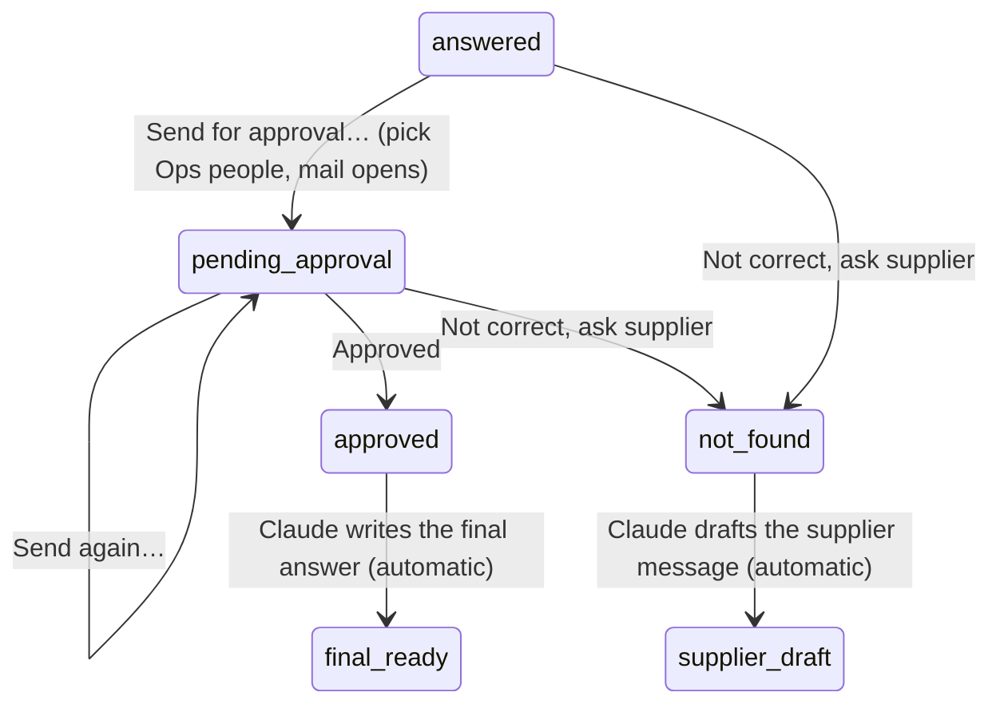
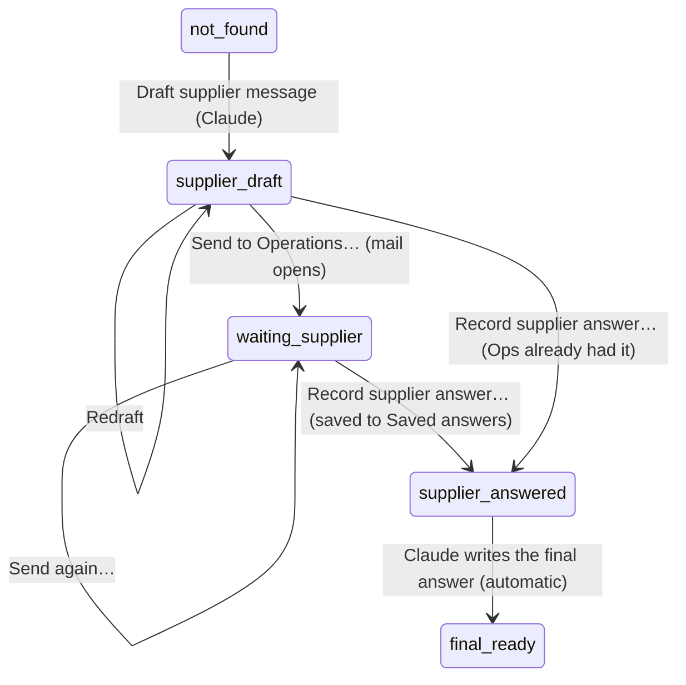
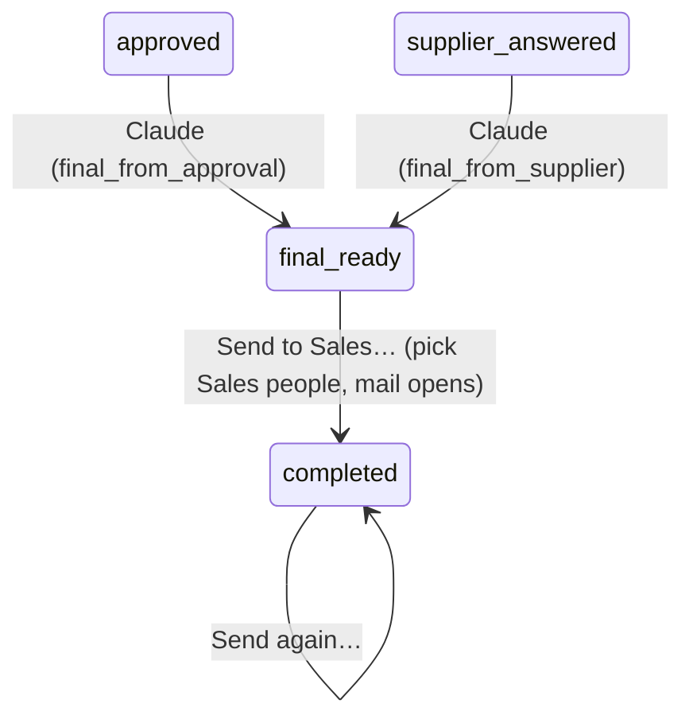

# Request workflow — state machines

The target flow is [expected_workflow.png](expected_workflow.png). In Pricy, each chat is one request, and its `status` is a deterministic finite automaton (DFA): it changes only through the transition function `next(status, event)` in [src-tauri/src/workflow.rs](../src-tauri/src/workflow.rs). Events that aren't allowed in the current state are rejected, and the UI only offers the actions that are valid (see [src/Workflow.tsx](../src/Workflow.tsx)).

- **People** trigger events with buttons: sending an email, marking approved or not correct, recording the supplier's answer.
- **Claude** triggers events when a turn finishes:
  - a search ends with a hidden marker, `[[pricy:found]]` or `[[pricy:not_found]]`, which the app removes before showing the answer;
  - a workflow step (supplier draft, final answer) fires its own event.
- **Sending** opens the user's mail app (`mailto:`) with the team members ticked in the send dialog and a prefilled message. The team list is set in Settings → Team (`Name <email>`, one per line). Sales and Operations sit in the same office, so approvals are recorded in Pricy by whoever runs the request.

## Full state machine



| State | Meaning | Diagram step |
|---|---|---|
| `new` | No answer yet | 1 |
| `answered` | The search found a price | 2 → A |
| `not_found` | No price found, or the answer was marked not correct | 2 → B |
| `pending_approval` | Sent to Operations for approval | A3 |
| `approved` | Operations approved | A3 done |
| `supplier_draft` | Claude drafted the supplier message | B3 |
| `waiting_supplier` | Draft sent to Operations, who forward it to the supplier | B4 |
| `supplier_answered` | The supplier's answer was recorded and saved | B5 |
| `final_ready` | Claude wrote the final answer for Sales | A4 / B6 |
| `completed` | The final answer was sent to Sales | A4 / B6 done |

## Feature 1 — Search outcome (step 2)



- **Trigger:** a search turn ends. Claude adds the marker as the last line (instructions are in [system_prompt.md](../src-tauri/src/system_prompt.md)). [`strip_outcome`](../src-tauri/src/workflow.rs) removes it and fires the event.
- **No marker** (Claude only asked for missing details): the status stays the same.
- Once a request has moved on (approval, supplier), follow-up searches no longer change its status.

## Feature 2 — Operations approval (A3, A4)



| Action (button) | Event | Records in the chat |
|---|---|---|
| Send for approval… | `sent_for_approval` | "Sent for approval to …" with the request and proposed answer in the email |
| Approved… (pick who approved, plus the chosen option / note) | `approved`, then step `final_from_approval` | "Approved by Marco: Option 2…", then a **Supplier Notes for Sales** card |
| Not correct — ask supplier | `rejected`, then step `draft_supplier` | "Answer marked as not correct", then a **Message to the supplier** card |

## Feature 3 — Ask the supplier (B3, B4, B5, B6)



- **B3:** step `draft_supplier`. Claude fills the fixed supplier template (Dear Team… Date, Number of Pax, Luggage / No Luggage, Service Type, Itinerary, Pick-up, Drop-off… Best regards,) from the request. Unknown fields become "To be confirmed". It runs on the same Claude session with no tools.
- **B4:** Operations forwards the draft to the supplier (WhatsApp or email, outside Pricy).
- **B5:** the reply is pasted into *Record supplier answer*. It is saved as `workspace/sources/answers/<date>-<request>.md`, which the **Saved answers** source searches next time. This is the "database" in the diagram.
- **B6:** step `final_from_supplier` writes the Supplier Notes from the supplier reply. Whoever forwarded the answer is recorded as the approver.

## Feature 4 — Final answer to Sales (A4, B6)



If a final-answer step fails or is stopped, the request stays in `approved` / `supplier_answered` and the bar offers **Write final answer** to retry.

## Operations approval information (the search answer)

The search answer is what Operations reviews (it is also the body of the *Send for approval…* email). Claude always structures it with these sections ([system_prompt.md](../src-tauri/src/system_prompt.md)):

1. **Price & Supplier**: every supplier and pricing option, each as Net Price; with several options, which one goes to Sales.
2. **Price Validity**: the date or period each price is valid from; seasonal or date-specific.
3. **Price Source & Accuracy**: where each price was found; exact match or not; details of the similar service used; estimates and closest matches marked.
4. **Vehicle Type**: Japan and South Korea only; the vehicle checked for each quote.
5. **Important Notes & Special Requirements**: child seats, wheelchair access, luggage capacity, special passenger needs, extra costs or services.
6. **Sales Request Summary**: service, date, location, participants, itinerary, special requirements.

## Supplier Notes (the final answer for Sales)

Both branches end with the Supplier Notes. Sales copies them into the Supplier Notes section in TINT:

```
Service Name & Description: one sentence
Price Requested By:          Settings → Your name
Price Approved By:           who approved (A3) or forwarded the supplier answer (B5)
Net Price:                   … (Net Price)
Supplier Name:
Are there additional quotes from other suppliers? Yes / No, and the options
Claude Output Link:          Pricy request "<title>" (<date>, ID <id>)
```

Pricy requests are stored locally, so there is no shareable URL for "Claude Output Link". The request title, date and ID identify it instead.

## Token usage

Every Claude turn (searches and steps) stores the usage reported by the CLI on the answer it produced:
- input, cache write, cache read and output tokens;
- API-equivalent cost;
- duration and number of model calls.

It is shown under each answer, and the chat header shows the total for the request.

## Not covered yet

- Approvals are recorded by the person running the request. Operations doesn't get an in-app inbox. That would need a shared backend, or Slack as the channel.
- Emails open in the local mail app. Pricy doesn't send them or read replies.
- **Saved answers** are local to each computer.
